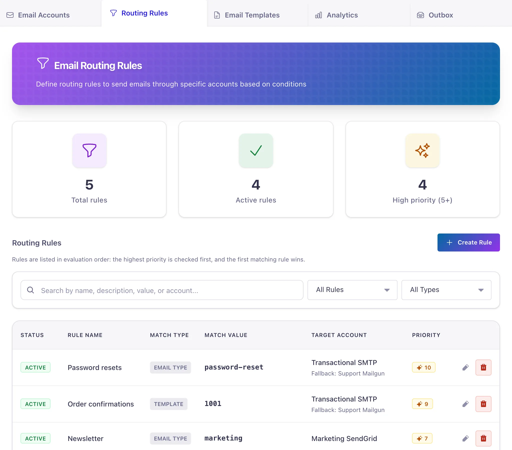
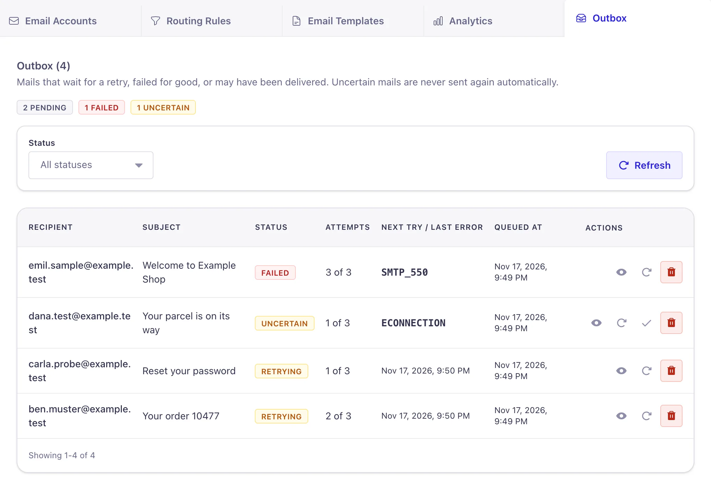
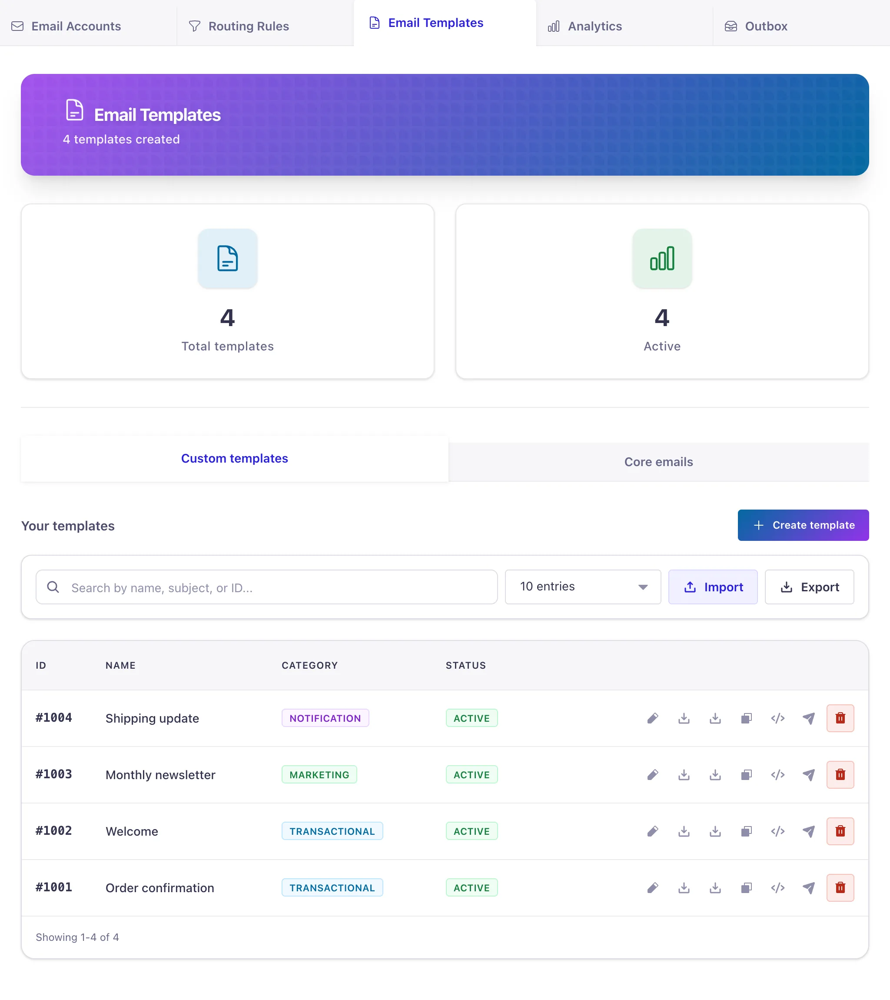
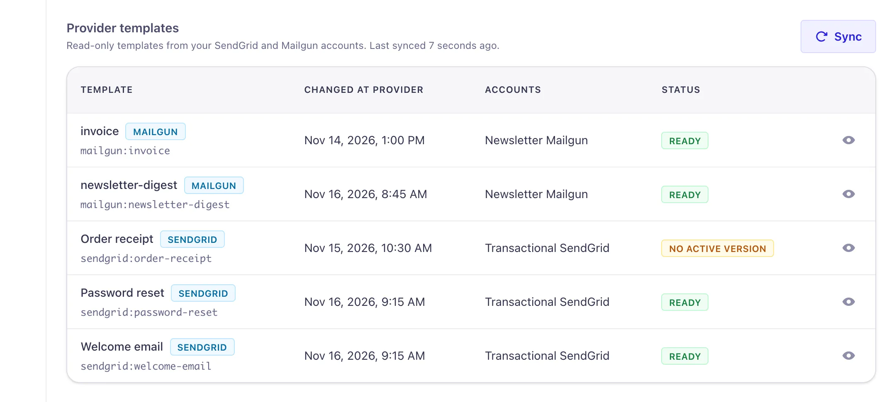
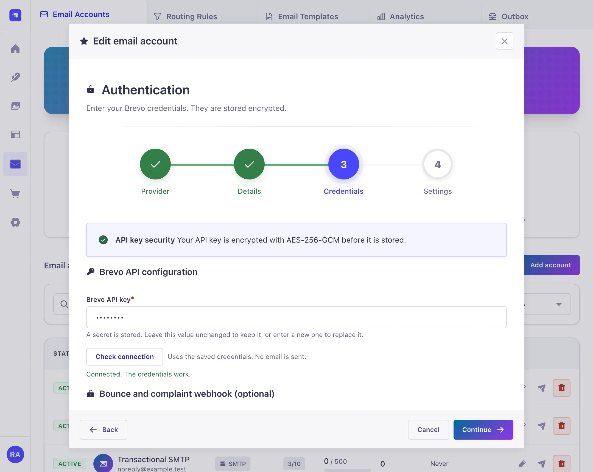
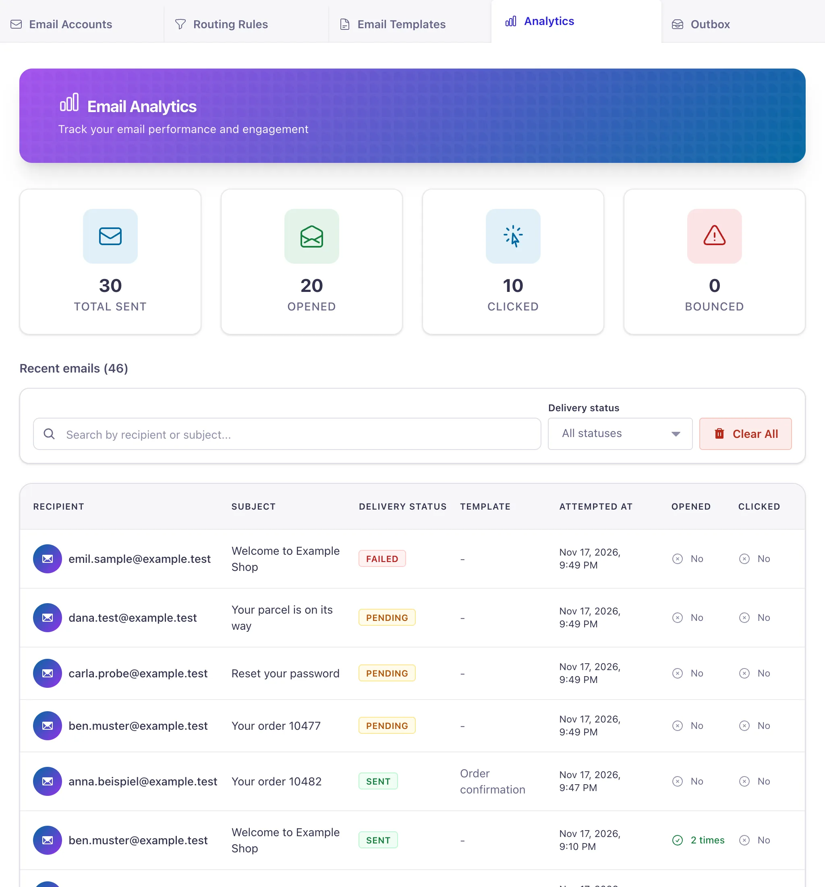
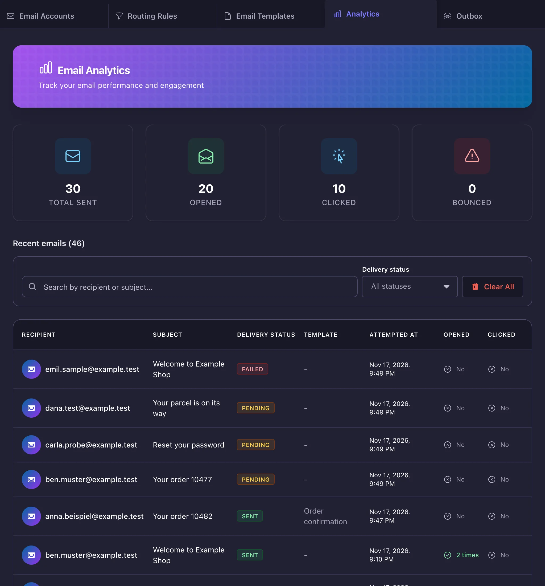

<p align="center">
  
</p>

# MagicMail for Strapi 5

Send every Strapi email through the right account: several SMTP and API accounts, routing rules, quotas, failover that never doubles a mail, an outbox with retries, templates and delivery tracking, all inside the Strapi admin.

[](https://www.npmjs.com/package/strapi-plugin-magic-mail)
[](https://www.npmjs.com/package/strapi-plugin-magic-mail)
[](https://github.com/Schero94/Magic-Mail/actions/workflows/ci.yml?query=branch%3Amain)
[](https://github.com/Schero94/Magic-Mail/blob/main/LICENSE)
[](https://github.com/Schero94/Magic-Mail#compatibility)
[](https://schero94.github.io/Magic-Mail/)

Live docs: https://schero94.github.io/Magic-Mail/

Your code keeps calling `strapi.plugin('email').service('email').send()`. Strapi's password-reset mail and every Users & Permissions mail go through MagicMail without changes. MagicMail picks the account, reserves its quota, logs the mail and tells you what happened to it.

MagicMail sends email only. It is MIT licensed, with no license key, tiers or usage limits.

## What you get

- **Eight providers.** Gmail, Microsoft 365 and Yahoo with OAuth 2.0, any SMTP server (optional DKIM), SendGrid, Mailgun, Brevo and Amazon SES (API v2, any commercial or GovCloud region). Credentials are encrypted with AES-256-GCM and never reach the browser.
- **Routing rules.** Choose the account by email type, recipient, subject, template or a custom value, with a fallback account per rule.
- **Quotas and safe failover.** Hourly and daily limits per account, reserved atomically. When an account fails, the next one is tried only if the error proves the provider did not take the mail, so a mail is never delivered twice by failover.
- **Outbox with retries.** Opt-in per send or for every failed send: 3 retries by default (after 1, 5 and 15 minutes, configurable from 1 to 10), idempotency keys, and an Outbox tab where you retry, discard or mark uncertain mails as sent.
- **Delivery webhooks.** Verified SendGrid, Mailgun, Brevo and Amazon SES (SNS) webhooks record bounces, blocks, complaints, deferrals, deliveries and unsubscribes on the delivery log, feed the suppression list and emit events other plugins can listen to.
- **Templates.** A visual editor (Unlayer) or plain HTML and text, Mustache variables, versions with restore, import and export, plus the Users & Permissions reset and confirmation mails.
- **Provider templates.** Keep designing in SendGrid, Mailgun, Brevo or Amazon SES: their templates appear read-only in MagicMail, with preview, test send, language versions and the same template data your code already passes. Routing, failover and logs stay in MagicMail, and the password-reset, confirmation and admin password-reset mails can use them too ([core emails](https://github.com/Schero94/Magic-Mail/blob/main/docs/sending.md#provider-templates-sendgrid-mailgun-brevo-amazon-ses)).
- **Analytics.** A delivery log with server-side search, open and click tracking with truncated IPs and configurable retention.
- **Several instances.** Railway replicas or pm2 workers on one database work without sticky sessions or Redis.
- **Admin in five languages.** English, German, French, Spanish and Portuguese, in light and dark mode.

## What's new

- **See every sent email as the customer got it:** click a row in Analytics to open its details, a safe preview (no scripts, no tracking, images only on request, desktop and mobile width, plain text) and its variables. Passwords, tokens, codes and sign-in links are hidden before anything is stored ([privacy](#security-and-privacy)).
- **Honest open and click columns:** "Not tracked" instead of a zero when tracking was not applied, and a notice when tracking is off or has no public URL.
- **Brevo and Amazon SES accounts:** send, check the connection without sending, sync their templates and receive bounces, complaints and deliveries (Brevo with a MagicMail webhook token, SES through SNS with signature checks) ([Brevo](https://github.com/Schero94/Magic-Mail/blob/main/docs/sending.md#brevo), [Amazon SES](https://github.com/Schero94/Magic-Mail/blob/main/docs/sending.md#amazon-ses)).
- **Language versions of provider templates:** map `de`, `fr`, `pt-BR` … to translated templates; MagicMail picks the version from `locale` or the user's stored locale, falling back to the language and then the default ([details](https://github.com/Schero94/Magic-Mail/blob/main/docs/sending.md#language-versions)).
- **Opens and clicks for provider templates:** with _Count provider opens and clicks_ on, the provider tracks the mails it renders and its open and click events appear in Email Analytics ([details](https://github.com/Schero94/Magic-Mail/blob/main/docs/delivery.md#provider-opens-and-clicks)).
- **SendGrid EU regional subusers:** choose region **EU** in the account to send through `api.eu.sendgrid.com` ([setup](https://github.com/Schero94/Magic-Mail/blob/main/docs/sending.md#sendgrid)).
- **Fewer provider rejections:** duplicate recipients, SendGrid-reserved headers and oversized messages are handled before the request, with a clear error instead of a bare HTTP status.
- **No double tracking:** when MagicMail tracks opens and clicks, SendGrid and Mailgun tracking is switched off for that mail, so links are wrapped once.
- **Mailgun metadata:** email type and priority as variables plus a tag, so Mailgun logs and webhooks can be filtered.
- **Mailgun domains are checked when you save the account.** A pasted `https://` or trailing slash is removed for you; a value that is not a domain name is flagged right in the form instead of failing later when mail is sent.
- **Failed account tests say what to fix:** wrong API key, missing Mail Send permission, unverified sender, wrong Mailgun region, or a sandbox recipient that is not authorized yet.
- **Clearer key setup:** the wizard recommends keys that can only send mail (SendGrid Custom Access with Mail Send, Mailgun Domain Sending Key).
- **SendGrid and Mailgun webhooks record more outcomes:** deferred, delivered and provider unsubscribes, besides bounces and complaints ([setup](https://github.com/Schero94/Magic-Mail/blob/main/docs/delivery.md#bounces-and-complaints)).
- **Provider hard bounces feed the suppression list** when _Block hard-bounced recipients_ is on.
- **Analytics counts bounces** again, and SendGrid blocks are no longer shown as bounces.
- **SendGrid batches up to 768 KB are accepted** (limit 1 MB, `webhooks.maxBodyBytes`).

## Contents

- [What's new](#whats-new)
- [Screenshots](#screenshots)
- [Quick start](#quick-start)
- [Compatibility](#compatibility)
- [Sending email](#sending-email)
- [Permissions](#permissions)
- [Environment variables](#environment-variables)
- [Security and privacy](#security-and-privacy)
- [Documentation](#documentation)
- [Contributing](#contributing)
- [Showcase your company](#showcase-your-company)

## Screenshots

All screenshots show synthetic data (`example.test` addresses) on an isolated Strapi 5.62.0 host, captured at 1080 px wide and 2x pixel density so the text stays readable in a narrow column.

**Email accounts**: status, provider, priority, today's usage against the daily limit, total sent and last use, with edit, test and delete per account.


**Routing rules**: rules in evaluation order with match type and value, target and fallback account, and priority.



**Outbox**: mails waiting for a retry, failed for good, or uncertain, with attempts and the next try or last error code. Retry, mark as sent and discard per row.



**Templates**: Reference ID, category and status; edit in the visual or HTML editor, download, duplicate, code snippets, test send.



**Provider templates**: with a SendGrid or Mailgun account, their templates appear under your own, with the provider, the change date there, the accounts that have them and their status.



**Brevo and Amazon SES accounts**: the wizard asks only for what the provider needs, checks the connection without sending and shows the webhook URL and setup steps ([Amazon SES](https://github.com/Schero94/Magic-Mail/blob/main/docs/sending.md#amazon-ses) and [language versions](https://github.com/Schero94/Magic-Mail/blob/main/docs/sending.md#language-versions) have their screenshots in the sending guide).



**Analytics**: totals and the delivery log with server-side search, delivery status, opens and clicks per email.



**Dark mode**: every screen follows the Strapi admin theme.



More screens (account wizard, outbox details, template editor, settings, mobile) are in the [gallery on the docs site](https://schero94.github.io/Magic-Mail/#gallery).

## Quick start

About a minute in an existing Strapi 5 project:

```bash
npm install strapi-plugin-magic-mail
# yarn add strapi-plugin-magic-mail  |  pnpm add strapi-plugin-magic-mail
```

```javascript
// config/plugins.js (config/plugins.ts: export default () => ({ ... }))
module.exports = () => ({
  'magic-mail': { enabled: true },
});
```

```bash
# Outside development and test MagicMail needs an encryption key. Generate it once and keep it.
node -e "console.log(require('crypto').randomBytes(32).toString('hex'))"
# .env
MAGIC_MAIL_ENCRYPTION_KEY=<the generated value>
```

```bash
npm run build
npm run develop
```

Open **MagicMail → Email Accounts**, click **Add account**, pick a provider (see [Provider setup](https://github.com/Schero94/Magic-Mail/blob/main/docs/sending.md#provider-setup)) and use the account's **Test** action with your own address. From now on every `strapi.plugin('email')` call goes through MagicMail.

Keep the encryption key stable: without it the stored account credentials cannot be read. Super admins see MagicMail right away; other roles need the [permissions](#permissions) `access` and `read`.

## Compatibility

| MagicMail | Strapi                                     | Node.js                                           | Databases                                                                                |
| --------- | ------------------------------------------ | ------------------------------------------------- | ---------------------------------------------------------------------------------------- |
| 4.x       | `^5.57.0` (acceptance host: Strapi 5.63.0) | `>=22.12.0 <=26.x.x` (CI runs Node 22, 24 and 26) | PostgreSQL, MySQL 8, SQLite. Several processes: PostgreSQL tested, MySQL not load-tested |
| 3.1       | `^5.57.0`                                  | `>=20.19.0 <=26.x.x`                              | as Strapi                                                                                |

- Peer dependencies: `@strapi/strapi`, `@strapi/plugin-users-permissions` (every default Strapi app has it; the email log links to its users), `react`, `react-dom`, `react-router-dom` and `styled-components` as in a `create-strapi-app` project. `@strapi/design-system`, `@strapi/icons` and `react-intl` are optional peers, which the Strapi admin provides.
- The packed plugin installs with npm into a Strapi 5.63.0 project without plugin warnings, and its admin builds there (checked 2026-11-18). The yarn 1 and pnpm install check dates from Strapi 5.61.
- The minimum Strapi version is 5.57.0, the first release whose admin ships Design System 2.2.4, the version the MagicMail admin uses. CI also installs that floor (Strapi 5.57.0 with Design System 2.2.4) and runs the tests and the build against it.

### Compatibility canary

A scheduled workflow, `.github/workflows/canary.yml`, runs every Monday at 04:17 UTC and on demand (Actions → Compatibility canary → Run workflow). It installs the newest Strapi 5.x release over the lockfile and tests the plugin on the newest Node.js release, the newest LTS and every LTS line inside `engines.node`: the tests (including the integration tests that boot Strapi), the admin tests, the build and both verify scripts, as the `verify` job of `ci.yml` runs them.

A failure opens or updates one issue labelled `compat` ("Compatibility: Strapi X.Y.Z / Node A.B.C") with the failing jobs, the failing step and a log excerpt; the next green run closes it. The last passing and the last run are recorded in the closed issue "Compatibility canary state". A manual run can force a Strapi version (`strapi`) or Node.js versions (`node`), and `dry-run` prints the plan instead of writing issues. Pull requests that change the canary run it as a dry run. The logic lives in `.github/scripts/compat-canary.mjs` (byte-identical in every plugin of the workbench, unit-tested in `compat-canary.test.mjs`).

## Sending email

MagicMail wraps the provider of `@strapi/email` at startup, so existing code keeps working:

```javascript
await strapi.plugin('email').service('email').send({
  to: 'user@example.com',
  subject: 'Welcome to Example Shop',
  text: 'Thanks for signing up!',
  html: '<h1>Welcome!</h1><p>Thanks for signing up!</p>',
});
```

Both `send()` and `sendTemplatedEmail()` are routed, including Strapi's admin password-reset email and the Users & Permissions emails. When no MagicMail account is active, or every eligible account is over its quota, the mail goes through the Strapi email provider you configured before. Once a MagicMail account has attempted delivery, an error is returned instead, so nothing goes out twice.

Need a specific account, a template or the outbox? Use the router service:

```javascript
await strapi.plugin('magic-mail').service('email-router').send({
  to: 'customer@example.com',
  subject: 'Order confirmation',
  html: '<h1>Your order #12345</h1>',
  accountName: 'Transactional SMTP', // case-insensitive; never replaced by another account
  type: 'transactional',
});
// → { success: true, accountUsed: 'Transactional SMTP', messageId: '<…>', emailId: '…' }
```

Designed your email in SendGrid, Mailgun, Brevo or Amazon SES? Send the synced template with the same data a MagicMail template gets (only accounts that have the template send it):

```javascript
await strapi
  .plugin('magic-mail')
  .service('email-router')
  .send({
    to: 'customer@example.com',
    providerTemplate: 'sendgrid:welcome-email', // key shown in Email Templates → Provider templates
    data: { name: 'Ada', user: { email: 'customer@example.com' } },
    locale: 'de', // optional: picks the German language version when one is set
  });
```

All send options, attachments, unsubscribe headers, provider setup, routing rules, templates and [provider templates](https://github.com/Schero94/Magic-Mail/blob/main/docs/sending.md#provider-templates-sendgrid-mailgun-brevo-amazon-ses): [Sending guide](https://github.com/Schero94/Magic-Mail/blob/main/docs/sending.md). HTTP routes: [API reference](https://github.com/Schero94/Magic-Mail/blob/main/docs/api.md).

## Permissions

MagicMail registers seven admin actions under **Settings → Administration Panel → Roles → Plugins → MagicMail**:

| Action                            | Grants                                                                                                                                                              |
| --------------------------------- | ------------------------------------------------------------------------------------------------------------------------------------------------------------------- |
| `plugin::magic-mail.access`       | The MagicMail menu entry and page. No API access by itself                                                                                                          |
| `plugin::magic-mail.read`         | Read accounts, routing rules, templates, analytics and settings; render and export templates; the settings link                                                     |
| `plugin::magic-mail.manage`       | Create, update and delete accounts, rules, templates, logs and settings; OAuth setup                                                                                |
| `plugin::magic-mail.test-send`    | Send test emails (account test, Strapi-service test, template and provider-template test) and run the read-only Brevo/SES connection check; 10 per minute per admin |
| `plugin::magic-mail.queue.read`   | The Outbox tab and queue statistics (no mail content)                                                                                                               |
| `plugin::magic-mail.queue.manage` | Retry, discard, mark as sent and delete outbox mails                                                                                                                |
| `plugin::magic-mail.content.read` | View email content: the Preview and Variables tabs of a sent email (needs `read` too). Not granted automatically, except to Super Admins                            |

Typical roles:

- **Read-only:** `access` + `read`
- **Editor:** `access` + `read` + `manage`
- **Tester:** `access` + `read` + `test-send`

When upgrading to 4.4, every role that already had `read` gets `queue.read` and every role with `manage` gets `queue.manage`, once at startup. Super admins always have both.

Editing the Users & Permissions templates also needs the users-permissions email-template permissions; uploading images in the visual editor needs _Media Library → Create (upload)_. Details: [permission migration guide](https://github.com/Schero94/Magic-Mail/blob/main/docs/permission-migration.md).

## Environment variables

| Variable                              | Required                                                 | Purpose                                                                         |
| ------------------------------------- | -------------------------------------------------------- | ------------------------------------------------------------------------------- |
| `MAGIC_MAIL_ENCRYPTION_KEY`           | yes, unless `NODE_ENV` is unset, `development` or `test` | Credential encryption key (32+ bytes). Keep it stable and backed up             |
| `MAGIC_MAIL_ENCRYPTION_KEY_PREVIOUS`  | no                                                       | Previous key during a rotation (decrypt only; saving an account re-encrypts it) |
| `MAGIC_MAIL_OAUTH_STATE_SECRET`       | no                                                       | OAuth state signing secret (default: derived from the encryption key)           |
| `MAGIC_MAIL_TRACKING_SECRET`          | no                                                       | Tracking hash secret (default: derived from the encryption key)                 |
| `MAGIC_MAIL_TRACKING_SECRET_PREVIOUS` | no                                                       | Comma-separated old tracking secrets that stay valid                            |
| `URL`                                 | no                                                       | Legacy override of the OAuth callback base URL (default: `server.url`)          |
| `MAGIC_MAIL_ENABLE_DEBUG_ENDPOINT`    | no                                                       | `true` enables `GET /magic-mail/analytics/debug` outside production             |

Without `MAGIC_MAIL_ENCRYPTION_KEY`, a development key derived from `ADMIN_JWT_SECRET`/`APP_KEYS` is used only when `NODE_ENV` is unset, `development` or `test`; rotating those secrets then makes stored credentials unreadable. Any other environment (for example `staging`) refuses to start without the key.

Also set Strapi's `server.url` to your public URL (OAuth redirects, tracking links) and `server.proxy.koa: true` behind a reverse proxy.

Every plugin config key, the admin settings and the multi-instance setup are in the [configuration guide](https://github.com/Schero94/Magic-Mail/blob/main/docs/configuration.md).

## Security and privacy

- **Credentials.** SMTP passwords, API keys, AWS secret access keys, webhook tokens, OAuth tokens and DKIM keys are encrypted with AES-256-GCM (key derived from `MAGIC_MAIL_ENCRYPTION_KEY` with HKDF). The admin API returns the placeholder `********` instead of a secret, and changing the host, user, provider or OAuth client, or the IMAP host used for bounce monitoring, requires the secret again.
- **Admin routes.** Every route needs an authenticated administrator plus the capability listed in [Permissions](#permissions). `access` only shows the menu entry.
- **GraphQL.** With `@strapi/plugin-graphql` installed, MagicMail's content types are kept out of the GraphQL schema, so API tokens can not read or change logs, templates or settings through it.
- **Content API.** The send routes accept API tokens only (users-permissions roles only with `contentApi.allowUserRoles`), reject unknown fields, file-path and URL attachments, and share 60 requests per minute per token across all instances. Never enable them for the _Public_ role.
- **What goes out.** HTML is sanitised, `from` is pinned to the sending account's address, custom headers are allowlisted, and SMTP requires TLS 1.2 or newer with certificate checks (unless `allowInsecure` is set on a non-production or loopback host).
- **OAuth.** Callbacks are public but use a signed, single-use state with PKCE, bound to the admin who started the flow and stored in the database.
- **Webhooks.** SendGrid and Mailgun requests are verified with the provider signature and a one-hour timestamp window; Brevo requests need the account's random webhook token (compared in constant time; shown only to admins with `manage` in a browser session, every reveal is audit-logged); Amazon SES (SNS) messages need the configured topic ARN and a valid SNS signature from an AWS SNS certificate host; replays are ignored and bodies are capped (1 MiB by default). Provider messages are not stored; addresses only as a keyed hash plus a masked form (suppression list) or a masked form (events for cc/bcc recipients). Brevo and Mailgun events only update mail of their own account.
- **Bounce mailbox.** Anyone can write to it, so a delivery report suppresses an address only when it refers to a mail MagicMail sent (outbox header or its random Message-ID) and names one of that mail's recipients. Email logs keep keyed hashes of the to/cc/bcc addresses for this check, never cc/bcc in clear text.
- **Tracking.** Open and click events keep IPs truncated to /24 or /48 and no location, and expire after 90 days (links after 180 days). Authentication links are never tracked. Mention tracking in your privacy notice.
- **Email preview.** For each send MagicMail stores the template version (a content hash), the template data and the `{{system.*}}` tags, so Analytics can re-render the email. Secrets are masked before storing: keys that name a secret (password, token, secret, otp, jwt, key, code, reset, confirmation, session, auth and similar), values that look like tokens (JWTs, long hex or random strings, UUIDs) and URLs with tokens (`?code=`, `?confirmation=`, `?token=`, `?loginToken=`, signatures, token path segments), which covers Strapi reset-password, email-confirmation and magic links. Add names to _Always hide these variables_ or _Never hide these variables_ in the settings. _Store a copy of sent emails_ (off by default) also keeps the final HTML and text, masked and compressed (512 KB cap). Everything follows _Keep email content for_ (30 days by default) and never outlives the log. The preview runs in a sandboxed frame without links, removes tracking pixels, and blocks remote images until "Load images". Viewing needs `content.read` and is audit-logged.
- **Outbox.** Queued mails are stored encrypted and deleted once sent or discarded; the admin API and the Outbox tab never show mail content. `forgetRecipient(address)` removes a recipient's queued mails.
- **Logs.** MagicMail's log lines carry error names and codes, not recipient addresses or message content.
- **Third parties.** Mails go only to the providers you configure. The visual template editor loads Unlayer's editor in the admin's browser (see [the visual editor and privacy](https://github.com/Schero94/Magic-Mail/blob/main/docs/sending.md#the-visual-editor-unlayer-and-privacy)); the plain HTML editor needs no third party.
- **Supply chain.** Releases are published from GitHub Actions with npm provenance.

**Reporting a vulnerability:** use [GitHub private vulnerability reporting](https://github.com/Schero94/Magic-Mail/security/advisories/new). Please do not open a public issue for security problems.

---

## Documentation

| Guide                                                                                                         | What it covers                                                                                                                                                               |
| ------------------------------------------------------------------------------------------------------------- | ---------------------------------------------------------------------------------------------------------------------------------------------------------------------------- |
| [Docs site](https://schero94.github.io/Magic-Mail/)                                                           | Overview, screenshot gallery, install, outbox, several instances                                                                                                             |
| [Sending, providers, routing and templates](https://github.com/Schero94/Magic-Mail/blob/main/docs/sending.md) | Send options, attachments, Gmail/Microsoft 365/Yahoo/SMTP/SendGrid/Mailgun/Brevo/Amazon SES setup, routing rules, quotas, failover, templates, the visual editor and its CSP |
| [Tracking, bounces and the outbox](https://github.com/Schero94/Magic-Mail/blob/main/docs/delivery.md)         | Open and click tracking, retention, bounce webhooks and mailbox monitoring, recipient checks, retries and the outbox                                                         |
| [Content API and Admin API](https://github.com/Schero94/Magic-Mail/blob/main/docs/api.md)                     | Every route with request, response and error examples                                                                                                                        |
| [Configuration and several instances](https://github.com/Schero94/Magic-Mail/blob/main/docs/configuration.md) | Every config key, admin settings, account fields, service API, Railway replicas and pm2 clusters                                                                             |
| [Troubleshooting and FAQ](https://github.com/Schero94/Magic-Mail/blob/main/docs/troubleshooting.md)           | Mail not received, OAuth errors, 400/403/429 responses, CSP, DMARC                                                                                                           |
| [Live webhook checks](https://github.com/Schero94/Magic-Mail/blob/main/docs/live-webhook-checks.md)           | Checking the SendGrid and Mailgun webhooks against your real accounts: test buttons, a real bounce, what to expect                                                           |
| [Upgrading](https://github.com/Schero94/Magic-Mail/blob/main/docs/upgrading.md)                               | Migration notes for every release since 4.0.0                                                                                                                                |
| [Permission migration](https://github.com/Schero94/Magic-Mail/blob/main/docs/permission-migration.md)         | Granting the 4.x admin capabilities                                                                                                                                          |
| [Changelog](https://github.com/Schero94/Magic-Mail/blob/main/CHANGELOG.md)                                    | Every release                                                                                                                                                                |

## Contributing

Bug reports, fixes and documentation improvements are welcome.

- **Bug?** [Open a bug report](https://github.com/Schero94/Magic-Mail/issues/new?template=bug-report.yml) with your Strapi, Node.js and MagicMail versions and the `[magic-mail]` log lines (remove addresses and secrets first).
- **Idea?** [Open a feature request](https://github.com/Schero94/Magic-Mail/issues/new?template=feature-request.yml).
- **Security issue?** See [Security and privacy](#security-and-privacy).

Development setup:

```bash
npm ci --ignore-scripts
npm run lint
npm run format:check
npm test
npm run test:admin
npm run build
npm run verify
npm run verify:runtime
```

`npm run test:live` runs the opt-in live suites against the real SendGrid and Mailgun APIs: the send paths (`tests/live/provider-send.live.test.js`), the provider-template flows (`tests/live/provider-templates.live.test.js`) and the rest of the SendGrid integration (`tests/live/sendgrid-account.live.test.js`: restricted API keys, template versions, read-only account checks; it creates temporary `magic-mail-live-*` API keys and templates and deletes them again, so its key needs full access). SendGrid runs in sandbox mode and Mailgun in test mode, so nothing is delivered (Mailgun bills test-mode messages). Credentials come only from `~/.config/magic-mail-live/.env` and are never printed. `LIVE_PROVIDERS` (environment variable or a line in that file) picks the providers as a comma-separated list of `sendgrid`, `mailgun`, `brevo` and `ses`; without it, every provider whose required variables are complete runs. Tests of a provider that is not selected are skipped with the reason. For SendGrid only: `LIVE_PROVIDERS=sendgrid npm run test:live`. Required per provider: SendGrid needs `SENDGRID_API_KEY`, `SENDGRID_FROM`, `LIVE_TEST_RECIPIENT` and, for the template suite, `SENDGRID_TEMPLATE_ID`; Mailgun needs `MAILGUN_API_KEY`, `MAILGUN_DOMAIN`, `MAILGUN_REGION`, `LIVE_TEST_RECIPIENT` and, for the template suite, `MAILGUN_TEMPLATE`. Optional: `SENDGRID_REGION`, `SENDGRID_EU_API_KEY`, `SENDGRID_EU_FROM`, `MAILGUN_FROM`, `MAILGUN_EU_DOMAIN`, `MAILGUN_EU_API_KEY`. Without the file, or when a selected provider misses a variable, the template suite fails with the file name and the missing variable names (the send suite reports those tests as skipped). Brevo (`tests/live/brevo.live.test.js`, sandbox header `X-Sib-Sandbox: drop`, nothing delivered) needs `BREVO_API_KEY`, `BREVO_FROM`, `BREVO_TO` and optionally `BREVO_TEMPLATE_ID`; Amazon SES (`tests/live/ses.live.test.js`, only the SES mailbox simulator `success@` and `bounce@simulator.amazonses.com`) needs `SES_REGION`, `SES_ACCESS_KEY_ID`, `SES_SECRET_ACCESS_KEY`, `SES_FROM` and optionally `SES_CONFIGURATION_SET`, `SES_TEMPLATE_NAME`; both skip with the missing names when their variables are not set. It never runs in CI. Never commit that file.

`npm run test:admin` renders every admin entry point (the five sections of the MagicMail page with their dialogs, the template editor, the Plugin Settings page) inside `React.StrictMode` with the providers of the Strapi admin, in jsdom with a fake network. It fails on a mutation sent twice, a read repeated without aborting the first one, an interval, listener, connection or observer left after unmount, and any console error or warning. A separate CI job runs the same tests against React 19 for information only: the plugin's peer range is React 18, like the Strapi 5 admin.

`npm run test:multi-instance` runs the multi-process suite (set `MAGIC_MAIL_TEST_PG_URL` for PostgreSQL). `npm run watch` (or `npm run watch:link` with yalc) rebuilds the admin and the server bundle on change. CI runs the same checks on Node 22 and 24 for every pull request and every push to `main`. Use [Conventional Commits](https://www.conventionalcommits.org/) (`fix:`, `feat:`, `docs:`); releases are cut from `main` by semantic-release.

### Dependency updates and the auto-merge gate

Dependabot proposes updates weekly, after a cooldown (7 days, 14 for majors). `.github/workflows/dependency-auto-merge.yml` handles its pull requests with the rules in `.github/scripts/dependency-gate.mjs`. The script is the same in every Magic plugin repository; its unit tests run with `node --test .github/scripts/dependency-gate.test.mjs` and in CI.

- **Merged automatically** (squash merge by `github-actions`): an explicit patch or minor update, after the repository's own checks pass, the gate finds nothing below, and every other check on the PR head commit has finished green: every CI job and matrix entry (for example Node versions, peer floor, React 19 StrictMode) and CodeQL where present. The merge is bound to that exact commit (`--match-head-commit`).
- **Held for review** (label `needs-review` plus a comment with the reasons, never merged automatically) when:
  - a changed package's `engines.node` no longer covers a Node version this plugin supports, or its `peerDependencies` no longer match the installed tree or this plugin's peer floor;
  - the PR body or release notes mention a breaking change;
  - the published surface changes: the `npm pack` file list (content hashes ignored), `exports`, `peerDependencies`, `engines`, or the exports of the built entry files;
  - a runtime dependency on 0.x gets a minor bump;
  - dependency review reports a vulnerability of moderate or higher, or a license outside the allowlist (MIT, MIT-0, ISC, BSD, Apache-2.0, 0BSD, BlueOak-1.0.0, CC0-1.0, Unlicense, Python-2.0, Zlib; MPL-2.0 and CC-BY for development dependencies only);
  - `npm audit signatures` reports a missing or invalid registry signature or provenance attestation;
  - the lockfile adds a package with an install script, more than 15 packages that are new to the tree, or a package that does not resolve from `registry.npmjs.org`;
  - a check fails, or the CI does not finish within 75 minutes.
- **Major updates** get the `major-update` label and a comment; a person reads the changelog and merges by hand.

The gate script runs from the default branch and reads lockfiles and reports as data; it never runs code from the pull request. Only the surface job installs (without lifecycle scripts) and builds the pull request, with a read-only token. Merges made with `GITHUB_TOKEN` do not start `release.yml`, so a dependency update ships with the next regular release.

**Dependency audits.** Run `npm audit` from your Strapi project root to check the complete installed tree; npm applies overrides from the root project only. MagicMail validates every request with its own zod (`^4.6.7`) and bounds all collections. Strapi itself ships other zod copies inside `@strapi/*` packages; if `npm audit` in your project reports one of them, the fix comes with a Strapi update.

**Maintenance status.** Actively maintained. Releases follow semantic versioning and support the Strapi 5 line.

**Languages.** The admin UI is available in English, German, French, Spanish and Portuguese.

## Showcase your company

Using MagicMail in production? [Add your company](https://github.com/Schero94/Magic-Mail/issues/new?template=showcase.yml) to the "Used by" section of the [documentation site](https://schero94.github.io/Magic-Mail/#used-by). The form asks for the company name, the website, a logo (PNG, JPEG or WebP, uploaded to the issue) and an optional one-line description.

A maintainer reviews every request and approves it with the `showcase-approved` label. `.github/workflows/showcase.yml` then validates the issue with `.github/scripts/showcase.mjs`, converts the logo to a WebP of at most 320 x 160 pixels and opens a `docs:` pull request that changes `docs/site/showcase.json`. The logo appears on the site after that pull request is merged. Website links carry `rel="ugc noopener"`. To remove an entry, open an issue that names the company; a maintainer then applies the `showcase-remove` label.

## License

MIT License, Copyright © 2025 Schero D. See [LICENSE](https://github.com/Schero94/Magic-Mail/blob/main/LICENSE).

Built with [Strapi](https://strapi.io), [Nodemailer](https://nodemailer.com), [Unlayer](https://unlayer.com) / [react-email-editor](https://github.com/unlayer/react-email-editor), [Heroicons](https://heroicons.com) and [styled-components](https://styled-components.com).
